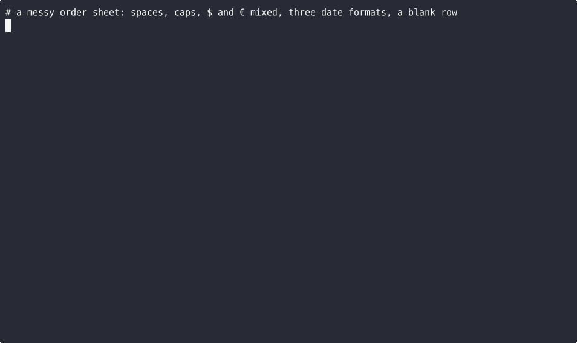

# sheet-cleaner



For the spreadsheet everyone keeps fixing by hand. Names with extra spaces, emails in caps, amounts written five different ways, dates in three formats, a blank row in the middle, the same customer twice.

Give it the file and a few rules. You get back a clean copy, and nothing disappears without a reason.

## What you get

`clean.csv` and `clean.xlsx` hold the rows that passed, with a `source_row` column so you can find each one in the original.

`rejects.csv` lists every row that didn't pass, with the reason and its original values. For example "amount='TBD' is not a valid money" or "duplicate of row 7 on email, order_date".

`changes.csv` lists every cell that was changed: row, column, old value, new value.

`report.md` gives the counts and the rejected rows in one page.

Rows in always equals clean plus rejected. The tool checks that itself before it writes anything.

## Rules

```json
{
 "rename": {"e_mail": "email", "amount_paid": "amount"},
 "required": ["customer_name", "email"],
 "types": {"amount": "money", "qty": "int", "order_date": "date", "email": "email"},
 "dedupe_on": ["email", "order_date"]
}
```

Headers are tidied first (`" Customer Name "` becomes `customer_name`), then renamed.

Types: `text`, `int`, `number`, `money`, `date`, `email`. Money handles `$1,234.50`, `(12.00)` as negative, `€7`. Dates come out as `2026-01-05` whatever they went in as.

If a money column mixes currencies, the odd ones are rejected rather than added up as if they were the same. Set `"currency": "$"` to say which one is expected.

`dayfirst: true` reads 03/04/2026 as 3 April. Duplicates ignore case unless you set `dedupe_ignore_case: false` (use that for product codes).

A rule that names a column the file doesn't have stops the run with an error, instead of quietly doing nothing.

## Use it

```
pip install -e .
sheet-cleaner orders.csv --rules rules.json --out out
```

Works on `.csv` (UTF-8 or Latin-1) and `.xlsx` (`--sheet` to pick one). `--strict` exits with code 1 if any row was rejected, so it can sit in a scheduled job.

## Tests

`./check.sh` runs the tests, then re-runs the example in `examples/` and fails if its counts move. The example data is made up.
